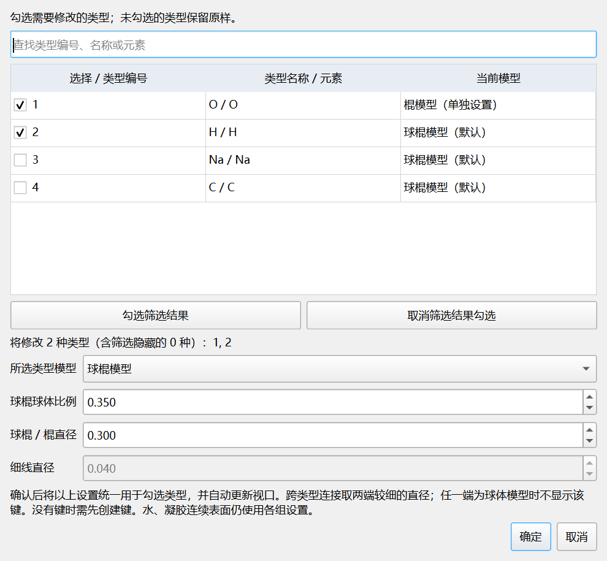

# 按原子类型设置模型 V1.6.6

1. 在原子类型表中选中要修改的一种类型；Ctrl/Shift可以多选。
2. 点击“设置所选类型模型…”；也可以在“模型样式与创建键”中点击“按原子类型设置模型…”。
3. 确认窗口中的勾选范围，选择球体、球棍、棍或细线。未勾选类型保留原样。
4. 调整球棍球体比例、球棍/棍直径或细线直径，点击确定。设置后自动更新视口。

例如：只勾选水氧和水氢类型，设置为棍模型；其他离子可保持球体或球棍。仅改变氧类型时，氢和其他类型的球体半径不会同时改变。

筛选不会取消已有勾选。窗口会显示全部勾选数量及其中被筛选隐藏的数量，请核对后确认。没有勾选时不修改任何类型。

模型设置随显示配置保存，适用于视口、实际渲染及轨迹动画。恢复默认样式只清除勾选类型的单独设置；其余类型仍保持原值。旧版全局配置继续有效，未单独设置的类型沿用原默认样式。

连接键两端的样式或直径不同，采用两端较细的直径；任一端为球体模型时，该连接键不显示。棍/细线需要已有键或先创建键，孤立原子显示为小节点。隐藏类型不会重新显示，水、凝胶等连续表面继续使用各组参数。

本次修改仅影响显示几何，不改写源文件坐标、类型、半径和键拓扑，不改变分析输入。

V1.6.5新增的保存位置选择继续保留：图和TXT/CSV在所选目录，JSON与处理日志在实际安装目录的运行记录文件夹。需要非C盘记录时，请安装到其他可写盘符。

退出旧版后，在原目录安装V1.6.6即可更新。有效设备授权继续使用。联系邮箱：3175911862@qq.com。
